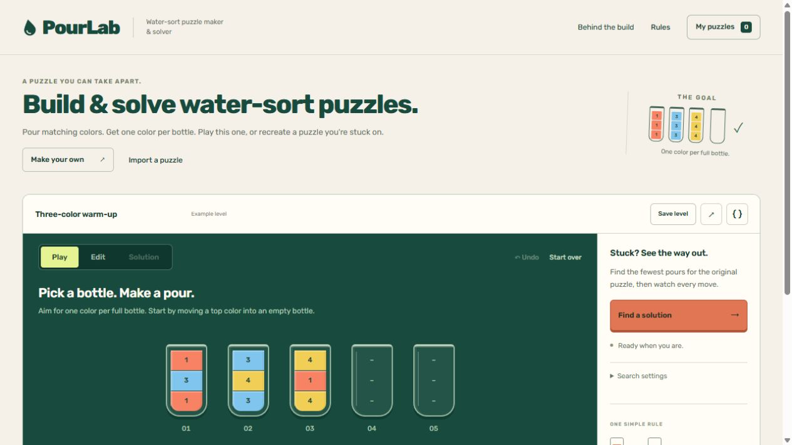

# PourLab

[Use the online studio](https://builtbyhuy.github.io/pourlab-puzzle-studio/) · [Guide & case study](https://builtbyhuy.github.io/pourlab-puzzle-studio/about.html) · [Detailed engineering case study](docs/CASE-STUDY.md)

A usable water-sort puzzle workbench: build your own levels, play them, and inspect a shortest checked solution. The application runs entirely in your browser with no account, application backend, level upload, analytics SDK or build step. It uses native browser APIs and locally hosted open-source fonts, with no third-party JavaScript runtime dependency in its application code. The hosting provider still receives page/resource requests and can add security checks.

This independent project was built with AI coding assistance. It uses **classical search**, not machine learning or reinforcement learning. The included study is synthetic; no player research, studio adoption, commercial results or human difficulty prediction is claimed.

## The studio

The interface connects creating a water-sort level, trying legal moves and reviewing a checked solution. See [current design decisions](docs/DESIGN.md) for the opening experience, layout, typography and interaction choices. The [earlier Cosmos source notes](docs/DESIGN-SOURCES.md#superseded-cosmos-instrument-direction) and corresponding screenshots record that earlier instrument presentation.



[Current mobile interface](docs/evidence/clarity-mobile.png) · [Earlier Cosmos redesign checks](docs/evidence/COSMOS-REDESIGN-QA.md) · [Current design decisions](docs/DESIGN.md) · [Artwork and font provenance](dist/assets/SOURCES.md)

## Start with a complete loop

Import the [three-color reviewer level](dist/assets/reviewer-level.json), try a legal move and Undo, then analyze its original arrangement. The recorded browser run reaches four shortest checked pours and replay 4/4. A one-state budget must remain unresolved; an unbalanced edit must disable Play/search until repaired. [Current replay](docs/evidence/clarity-replay-2026-10-21.png) · [Recovery repair](docs/evidence/STORAGE-RECOVERY-QA.md).

For the engineering comparison, [40 fixed configurations across 34 layouts](docs/SOLVER-EVALUATION.md) run both A* and BFS, check every solved path independently and expose the effect of search budgets. Run `node scripts/evaluate-solver.mjs --check`; independent optimum coverage and timing limits are explicit in the report.

## Try the whole workflow

Short mode transitions, source selection and an interruptible trace explain actual legal pours and adjacent replay steps. Game state updates immediately. The visible Motion control disables interactive feedback, and reduced-motion visitors start with it off. See [current design decisions](docs/DESIGN.md).

1. Start with the playable example, or choose **Make your own** and paint a slot in **Edit** mode, from the bottom upward. Every color also has a number.
2. Balance each used color to a multiple of the bottle capacity; add empty bottles if needed.
3. Choose **Play**, select a source bottle, then a legal target. Use **Undo** or **Start over** to revise the manual session.
4. Choose **Find a solution** to solve the original design, even after manual play. Inspect the legal replay with Previous, Next, the slider or playback.
5. Save a named level, reopen it from **My puzzles**, export a JSON backup, or copy a link containing the level.

You can create 2–12 bottles with capacity 2–6 and up to eight colors. Palette slots, bottle removal, capacity changes, erasing, editor undo and blank levels work on user-created content. Deterministic shuffling uses the visible seed, selected color count and current capacity. Its balanced inventory does **not** guarantee solvability; the search checks that separately.

## Run locally

Serve `dist/` using any static HTTP server. Opening `index.html` through `file://` cannot run the module worker.

```sh
python -m http.server 8080 --directory dist
```

Open `http://localhost:8080`. Python 3 is only one way to serve files; it is not an application dependency. Any static hosting service can publish the `dist` directory unchanged. HTTPS or localhost supports clipboard sharing; JSON export works without clipboard access.

## Test

Node 18+; no install needed:

```sh
npm test
# or
node --test tests/*.test.js
```

Tests compare both exact solvers with a separately implemented **labeled-bottle BFS oracle**, including exhaustive small arrangements and deterministic novel levels. They also check maximal-pour rules, immutable transitions, legal replay, conservation of inventory, strict input boundaries, unresolved budgets and portable JSON/link roundtrips. Browser rendering, actual worker startup, storage and keyboard flows require browser acceptance in addition to these unit tests.

The current suite has **17 checks**: eight rule/portability checks and nine storage regressions executing the production storage functions with controlled DOM, storage and confirmation boundaries. The latter protect unreadable original libraries, failed reads/writes, reset confirmation and stale-tab changes. [Recovery fix and actual-browser evidence](docs/evidence/STORAGE-RECOVERY-QA.md).

Current browser evidence covers the four-pour loop above, illegal play/Undo, edit invalidation, named save/reload and mobile rendering. The recovery follow-through also verified exact original backup bytes, visible storage failure feedback and a separate newly imported level saved, reloaded and solved. The [recorded scopes](docs/evidence/STORAGE-RECOVERY-QA.md) remain distinct from automated checks and human usability acceptance.

<details>
<summary>Earlier browser and motion evidence</summary>

An earlier three-color level produced a seven-pour solution: A* visited 48 states and BFS 93, with replay to 7/7. This is historical browser evidence, separate from the current frozen-corpus measurement.

[Desktop worker/replay evidence](docs/evidence/desktop-solver.jpg) · [Mobile evidence](docs/evidence/mobile-solver.jpg)

The worker/replay images above record the original release. The current visual design appears in the studio image near the top of this README.

The earlier white/glass interface was also checked in a real browser on 21 October 2026: custom JSON import, a seven-pour A* result, keyboard replay to 7/7, a legal manual pour and Undo, erase/repair inventory validation, named save and the library dialog. Both the studio and case-study page were inspected at a 390px viewport with no horizontal document overflow. All eight core/portability tests passed. These historical observations are not acceptance of the later instrument redesign, a user study or a complete accessibility audit.

[Historical glass-hero recording](docs/evidence/motion.gif) and retained Three.js files describe the superseded presentation. They are not loaded by the current studio; current feedback does not simulate fluid physics.

</details>

## Rule and data contract

```json
{
  "format": "pourlab",
  "version": 1,
  "name": "Three-color study",
  "capacity": 3,
  "bottles": [[0,1,2],[1,2,0],[2,0,1],[],[]]
}
```

Arrays run **bottom to top**. Colors are integers 0–7 (displayed as 1–8). A move transfers the maximum contiguous top run that fits into an empty bottle or onto the same color. A goal has full single-color bottles and empty bottles. Repeated-color inventories are allowed, provided each color count is a multiple of capacity.

Raw `{capacity,bottles,name?}` objects are also accepted. Import rejects unknown fields, invalid types, unsupported versions, control characters in names, oversized inputs and out-of-range values. An incomplete inventory can be imported/saved as a **draft**, but cannot enter Play or search until balanced. A library backup uses `{ "format":"pourlab-library", "version":1, "levels":[...] }`, limited to 50 levels and 300 KB. Library imports are additive and validate all records before writing.

## Honest search outcomes

- **Solved**: a shortest path was found and replayed through the same legal rules. Zero moves is valid for an already solved level.
- **Unsolvable**: the complete reachable state space was exhausted.
- **Limit reached**: a state, depth or time budget stopped this run. The search has not established solvability.
- **Stopped**: the worker was terminated by the user. No solvability conclusion is made.

A* uses an admissible color-segment heuristic. BFS is an exact shortest-path baseline. The default is A*, 80,000 states, five seconds and depth 100. Hard ceilings are 200,000 states, 15 seconds and depth 200; large valid puzzles can exceed these budgets. Search runs in a real module Web Worker. Edits cancel the worker and invalidate old solutions. Solver output is replay-verified again in the main thread before display.

## Storage and privacy

Named levels and a recovery draft use `localStorage` in the current browser origin. They do not sync across devices and may be removed by the browser. The app reports failed named saves, provides JSON backups and confirms deletion. A copied URL includes the level and its name in the hash; anyone with the link can open it. This app sends no level data to a server. Shared-link names and imported strings are rendered through text nodes, never HTML.

### Moving from the earlier demo address

The current demo address is `https://builtbyhuy.github.io/pourlab-puzzle-studio/`. If you used the [earlier hosted demo](https://pourlab-huy.hokhachuy1234.chatgpt.site/), open it in the browser where you saved your levels. Choose **My puzzles** to open the **My levels** dialog, then **Export all levels**. Import that JSON backup at the current address. Export an unsaved current level separately and check the imported levels before removing old copies. Browser storage is tied to its origin; changing the address does not move or erase the old data. There is no automatic redirect or background transfer. Existing shared links continue to target their original host.

The [Pages workflow](.github/workflows/pages.yml) runs the existing regression suite and fixed solver corpus before publishing only `dist/`. It uses GitHub's built-in workflow token and short-lived Pages identity; no separate deployment secret is required. Earlier browser evidence retains its original address and scope.

An unreadable saved library is protected against further writes. **My puzzles** offers its exact original raw text for download; resetting requires requesting that backup and a separate confirmation. A failed reset keeps the original. Draft-write failures remain visible with an export action. A changed-library check also refuses stale writes after another tab has updated the library; it is a guard, not an atomic cross-tab transaction.

## Architecture

| File | Responsibility |
|---|---|
| `dist/solver.js` | Pure rules, validation, deterministic generation, BFS, A*, replay |
| `dist/worker.js` | Isolated search protocol and progress messages |
| `dist/portable.js` | Strict JSON and bounded URL-hash serialization |
| `dist/app.js` | DOM interaction, history, storage, search cancellation, replay controls |
| `dist/interface-motion.js` | Interruptible selection, mode and legal-pour feedback; motion preference |
| `dist/index.html`, `style.css`, `playground.css`, `motion.css` | Native controls, responsive playable board and state-linked feedback |
| `tests/` | Independent oracle and rule/portability checks |

The app links to the public [project guide](dist/about.html). See [the case study](docs/CASE-STUDY.md) for tradeoffs, proof boundaries and next experiments.

## Tóm tắt tiếng Việt

PourLab là công cụ tạo, chơi và tìm lời giải ngắn nhất cho trò xếp nước, chạy trực tiếp trong trình duyệt. Người dùng tự tạo màn, lưu ở trình duyệt, nhập/xuất JSON hoặc chia sẻ bằng liên kết. A* và BFS là thuật toán tìm kiếm cổ điển; hết ngân sách tìm kiếm **không có nghĩa là vô nghiệm**. Đây là sản phẩm cá nhân có AI hỗ trợ viết mã, chưa có bằng chứng người dùng thực tế hay hiệu quả thương mại.
