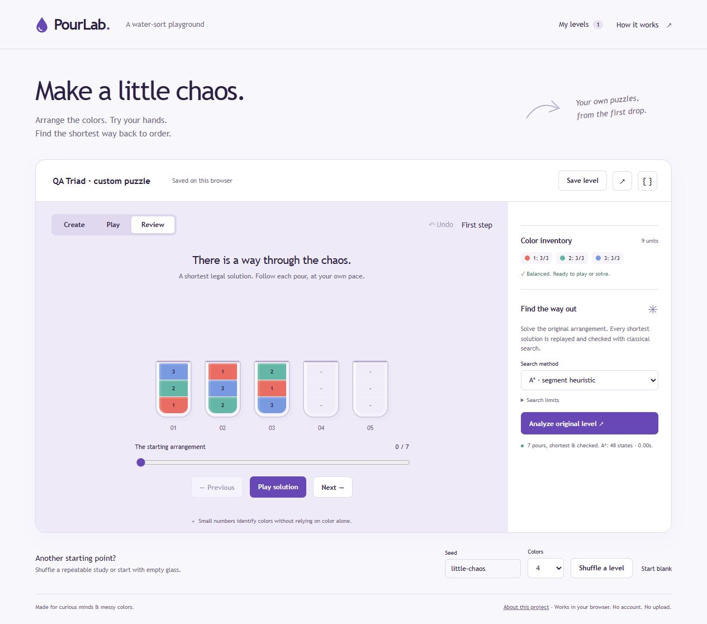

# PourLab

A usable water-sort puzzle workbench: build your own levels, play them, and inspect a shortest checked solution. Runs entirely in your browser with no account, backend, upload, tracking, build step or runtime dependency.

This independent project was built with AI coding assistance. It uses **classical search**, not machine learning or reinforcement learning. The included study is synthetic; no player research, studio adoption, commercial results or human difficulty prediction is claimed.

## Try the whole workflow

1. Paint a slot in **Create** mode, from the bottom upward. Every color also has a number.
2. Balance each used color to a multiple of the bottle capacity; add empty bottles if needed.
3. Choose **Play**, select a source bottle, then a legal target. Use Undo or Reset freely.
4. Choose **Analyze original level**. Inspect the legal replay with Previous, Next, the slider or playback.
5. Save a named level, reopen it from **My levels**, export a JSON backup, or copy a link containing the level.

You can create 2–12 bottles with capacity 2–6 and up to eight colors. Palette slots, bottle removal, capacity changes, erasing, editor undo and blank levels work on user-created content. Deterministic shuffling uses the visible seed, selected color count and current capacity. Its balanced inventory does **not** guarantee solvability; the search checks that separately.

## Run locally

Serve `dist/` using any static HTTP server. Opening `index.html` through `file://` cannot run the module worker.

```sh
python -m http.server 8080 --directory dist
```

Open `http://localhost:8080`. Python 3 is only one way to serve files; it is not an application dependency. Any static hosting service can publish the `dist` directory unchanged. HTTPS or localhost supports clipboard sharing; JSON export works without clipboard access.

## Test

Node 18+; no install needed:

```sh
npm test
# or
node --test tests/*.test.js
```

Tests compare both exact solvers with a separately implemented **labeled-bottle BFS oracle**, including exhaustive small arrangements and deterministic novel levels. They also check maximal-pour rules, immutable transitions, legal replay, conservation of inventory, strict input boundaries, unresolved budgets and portable JSON/link roundtrips. Browser rendering, actual worker startup, storage and keyboard flows require browser acceptance in addition to these unit tests.

Actual browser checks on 21 October 2026 used a novel three-color level: A* found a seven-pour solution after visiting 48 states; BFS found the same optimum after visiting 93 states. The browser replay reached step 7/7. Named save/reload, an illegal-pour error, Undo and a one-state budget reported as unresolved were also checked. These observations cover those flows, not a complete accessibility or user-acceptance study.

[Desktop worker/replay evidence](docs/evidence/desktop-solver.jpg) · [Mobile evidence](docs/evidence/mobile-solver.jpg)



## Rule and data contract

```json
{
  "format": "pourlab",
  "version": 1,
  "name": "Three-color study",
  "capacity": 3,
  "bottles": [[0,1,2],[1,2,0],[2,0,1],[],[]]
}
```

Arrays run **bottom to top**. Colors are integers 0–7 (displayed as 1–8). A move transfers the maximum contiguous top run that fits into an empty bottle or onto the same color. A goal has full single-color bottles and empty bottles. Repeated-color inventories are allowed, provided each color count is a multiple of capacity.

Raw `{capacity,bottles,name?}` objects are also accepted. Import rejects unknown fields, invalid types, unsupported versions, control characters in names, oversized inputs and out-of-range values. An incomplete inventory can be imported/saved as a **draft**, but cannot enter Play or search until balanced. A library backup uses `{ "format":"pourlab-library", "version":1, "levels":[...] }`, limited to 50 levels and 300 KB. Library imports are additive and validate all records before writing.

## Honest search outcomes

- **Solved**: a shortest path was found and replayed through the same legal rules. Zero moves is valid for an already solved level.
- **Unsolvable**: the complete reachable state space was exhausted.
- **Limit reached**: a state, depth or time budget stopped this run. The search has not established solvability.
- **Stopped**: the worker was terminated by the user. No solvability conclusion is made.

A* uses an admissible color-segment heuristic. BFS is an exact shortest-path baseline. The default is A*, 80,000 states, five seconds and depth 100. Hard ceilings are 200,000 states, 15 seconds and depth 200; large valid puzzles can exceed these budgets. Search runs in a real module Web Worker. Edits cancel the worker and invalidate old solutions. Solver output is replay-verified again in the main thread before display.

## Storage and privacy

Named levels and a recovery draft use `localStorage` in the current browser origin. They do not sync across devices and may be removed by the browser. The app reports failed named saves, provides JSON backups and confirms deletion. A copied URL includes the level and its name in the hash; anyone with the link can open it. This app sends no level data to a server. Shared-link names and imported strings are rendered through text nodes, never HTML.

## Architecture

| File | Responsibility |
|---|---|
| `dist/solver.js` | Pure rules, validation, deterministic generation, BFS, A*, replay |
| `dist/worker.js` | Isolated search protocol and progress messages |
| `dist/portable.js` | Strict JSON and bounded URL-hash serialization |
| `dist/app.js` | DOM interaction, history, storage, search cancellation, replay controls |
| `dist/index.html`, `style.css` | Accessible native controls and responsive glass workbench |
| `tests/` | Independent oracle and rule/portability checks |

The app links to the public [project guide](dist/about.html). See [the case study](docs/CASE-STUDY.md) for tradeoffs, proof boundaries and next experiments.

## Tóm tắt tiếng Việt

PourLab là công cụ tạo, chơi và tìm lời giải ngắn nhất cho trò xếp nước, chạy trực tiếp trong trình duyệt. Người dùng tự tạo màn, lưu ở trình duyệt, nhập/xuất JSON hoặc chia sẻ bằng liên kết. A* và BFS là thuật toán tìm kiếm cổ điển; hết ngân sách tìm kiếm **không có nghĩa là vô nghiệm**. Đây là sản phẩm cá nhân có AI hỗ trợ viết mã, chưa có bằng chứng người dùng thực tế hay hiệu quả thương mại.

