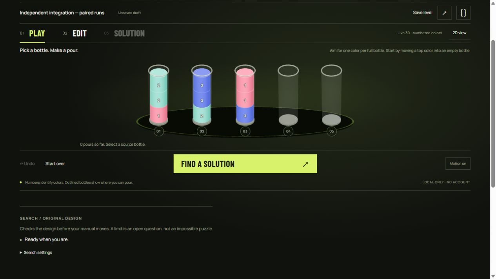

# OBSIDIAN integration — 21 October 2026

User selected the working OBSIDIAN prototype before full-product integration. Input levels are synthetic. The full2–12 bottle, capacity2–6 and eight-color production model remains; prototype restrictions were not copied into the product. This is engineering/browser evidence, not player research, commercial adoption, physical-device benchmarking or a complete accessibility audit.

## New-input browser loop

Root imported a new capacity3 level through the visible JSON dialog: `[[0,1,1],[1,2,2],[2,0,0],[],[]]`.

- Real3D Play displayed the new content, not a decorative still. Legal1→4 transferred the maximal two-unit run;2→4 was rejected with an explicit rule message and unchanged contents. Undo restored the original arrangement.
- After a manual1→4, Find a solution still searched the **original design**: real module Worker returned **four shortest checked pours,17 A* states**. The independent labeled BFS fixture also has optimum4.
- Next and Previous traversed legal frames; keyboard End on the slider reached4/4 and full single-color bottles. The replay capture below records that actual final state.
- Erasing one top unit made inventory invalid and disabled Play/search and the old solution. Undo repaired inventory without reviving the stale result.
- A one-state search was explicitly unresolved, not impossible. Raising the budget allowed the actual four-pour result again.
- Named saving, reload, actual JSON export and copying a portable level link retained the original design/name/capacity. Saves and links are local/portable data, not cloud sync.

[Exact reviewer input](../../dist/assets/reviewer-level.json) · [Actual checked replay](selected-replay.png).

## Independent presentation boundaries

An independent reviewer imported12 tubes with capacity6 and eight colors. After repair, Edit exposed72 precise slot controls without retained3D positioning; Play used a multirow3D layout, and all12 targets remained inside the board on desktop and390px viewport. A six-unit legal pour and Undo also worked in2D fallback.

Two real integration failures were found and repaired:

1. An old renderer could reapply five projected positions after entering Edit with12 tubes. Suspending before final projection cleanup removed the overlap; independent retest confirmed zero projected Edit wrappers and correct3D rows.
2. A deliberately failed stage3d module fetch stayed failed in the ESM cache. Explicit Retry3D now uses a fresh bounded module URL. Independent blocked-fetch→2D→network restored→Retry3D returned Live3D without reloading or losing the12-tube level. Test network overrides were removed.

3D uses original tube geometry and locally vendored Three.js0.180.0. It is stylized geometry animation, not fluid physics. Adjacent actual legal pours/replay steps receive a transition; Undo, edits, stale revisions and slider jumps do not invent one. Native projected controls remain keyboard accessible. Editing uses2D, and Play offers an explicit2D toggle.

The independent reviewer captured21 actual frames over about0.72seconds during a six-unit pour. [Before](selected-pour-frame-00.png), [mid-pour](selected-pour-frame-10.png), [after](selected-pour-frame-20.png) and [frame timestamps](selected-pour-frames.json) distinguish live geometric motion from a still. [Independent scope and discovered bugs](OBSIDIAN-INDEPENDENT-REVIEW.md). This is not a frame-rate benchmark or a forced GPU context-loss test.

Owner inspected manual Motion off, keyboard pouring/focus and live/fresh system reduced-motion: motion starts off/disabled while content changes still work. Repeated Edit/Play retained one canvas and the correct target count. Reduced-motion/network overrides were cleared. Mobile document width was375px for390px viewport, with no horizontal overflow. Browser observations supplement tests; they do not prove every hardware/context-loss behavior.

## Reproducible checks

**20 tests**: eight rules/portability, nine production-storage regressions and three presentation regressions (layout/move gating and failure/retry lifecycle). The fixed solver evaluation remains **40 configurations /34 layouts /80 runs /69 checked solved replays**. Independent optimum coverage and timing limits are documented in SOLVER-EVALUATION.md. Storage failure/reset/stale-tab branches are controlled regressions plus the separate historical STORAGE-RECOVERY-QA.md browser record; this redesign does not claim a new real browser-quota failure test.

[Phone capture](selected-mobile.png) · [Replay](selected-replay.png). Earlier clarity/Cosmos/glass captures keep their historical scope. Publication receipts are separate from local execution findings.
